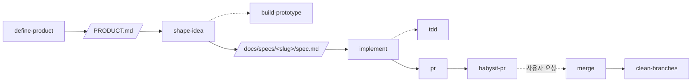

# 스킬 가이드: 프로젝트 구성 단계

프로젝트를 만들고 구성할 때 주로 쓰는 스킬이 무엇을 하고, 어떤 생각으로 설계되었는지 정리한 문서입니다.

- 규칙의 원문은 각 스킬의 `SKILL.md`입니다. 이 문서의 "설계 의도"는 그 규칙들이 공통으로 향하는 방향을 해석한 것이라, 둘이 다르면 `SKILL.md`를 따릅니다.
- `SKILL.md`와 `AGENTS.md`가 다르면 `AGENTS.md`를 따릅니다. 대표적인 차이는 [검증·리뷰 예산](#이-프로젝트의-검증리뷰-예산)에 정리했습니다.

## 전체 흐름

`add-stack-context`는 기술을 고르거나 추가할 때마다 켜지고, `setup-issue-tracker`는 병렬 구현 전에 사용자가 한 번 실행합니다.

## 1. 방향을 정하는 단계

### [`define-product`](../.claude/skills/define-product/SKILL.md)

**하는 일.** 인터뷰로 사용자, 사용 상황, 문제, 약속하는 변화, 핵심 루프, 경계를 끌어내 루트 `PRODUCT.md`에 기록합니다. 대략적인 출발 방향조차 없으면 파일을 만들지 않고 멈춥니다. 끝나면 핵심 루프를 한 번 끝까지 도는 가장 얇은 작업 단위 하나를 `shape-idea`에 넘길 제안으로 붙입니다.

**설계 의도.**

- 제품의 의미는 사용자가 가진 것이고, AI는 그것을 끌어내는 역할입니다. 그래서 열린 질문만 하고, "누구나", "쉽게", "빠르게" 같은 말을 확정된 뜻으로 번역하지 않습니다.
- 침묵이나 정보 부족은 결정이 아닙니다. 사용자가 확인한 의미, 위임한 선택, 받아들인 가정, 모르는 채 두기로 한 것, AI의 제안을 따로 구분합니다.
- 코드는 현재 동작의 증거일 뿐 의도의 증거가 아닙니다.
- 문서는 연대기가 아니라 현재의 단일 기록이므로 제자리에서 덮어씁니다.

### [`add-stack-context`](../.claude/skills/add-stack-context/SKILL.md)

**하는 일.** 매니페스트에서 직접 쓰는 기술(프레임워크, 라이브러리, 도구, 호스팅 서비스)을 목록으로 만들고, 항목마다 스킬과 벤더 공식 자료를 찾아 설치합니다. 자주 바뀌는 문서(`llms.txt` 등)는 복사하지 않고, 작업을 시작할 때 가져오라는 지시를 `AGENTS.md`에 남깁니다. 모든 항목은 "설치됨, 이미 있음, 공식 출처 없음, 차단됨" 중 하나로 끝나야 합니다.

**설계 의도.**

- 신뢰의 근거는 인기가 아니라 소유 관계입니다. 검색 순위, 설치 수, 저장소 star는 벤더가 만든 스킬이라는 증거가 되지 않습니다. 커뮤니티 스킬은 사용자 승인 후에만 설치하고, 공식 자료로 취급하지 않습니다.
- 빨리 낡는 지식은 복사하지 않고 필요할 때 가져옵니다. `AGENTS.md`의 Vercel, OpenAI, Supabase 문서 규칙이 이 방식으로 만들어진 결과입니다.
- 모든 항목이 결과 하나를 가져야 끝나므로, 빠뜨린 기술이 남지 않습니다.

### [`setup-issue-tracker`](../.claude/skills/setup-issue-tracker/SKILL.md)

**하는 일.** 저장소마다 한 번, 이슈 트래커 규약을 `AGENTS.md`의 `## Issue tracker` 섹션과 `docs/issue-tracker.md`에 기록합니다. 구현 계약은 spec 폴더이고, `spec.md`의 `Issue: <tracker>:<id>` 한 줄이 이슈와의 유일한 연결입니다. 모델이 스스로 호출하지 않고 사용자가 직접 실행하는 스킬입니다(`disable-model-invocation: true`).

**설계 의도.**

- 연결은 추정이 아니라 기록된 ID로 합니다. 제목 검색으로 이슈를 찾지 않습니다.
- 규약을 저장소 문서에 두어서, 스킬이 설치되어 있지 않아도 다른 도구가 읽을 수 있게 합니다. 지식은 저장소에 두고 스킬은 절차만 맡습니다.
- 이 섹션이 없으면 다른 스킬의 이슈 관련 동작이 모두 꺼집니다. 현재 `AGENTS.md`에는 이 섹션이 없으므로, 이 프로젝트에서는 이슈 단계가 꺼져 있습니다.

## 2. 합의하는 단계

### [`shape-idea`](../.claude/skills/shape-idea/SKILL.md)

**하는 일.** 문제와 방향을 한 번에 결정 하나씩 합의해 `docs/specs/<slug>/spec.md`로 확정합니다. spec에는 사용자에게 보이는 결과, 범위, 관찰 가능한 수용 기준, 제약, 가정, 건드리면 안 되는 영역, 미룬 결정, 위험, 구현 전 설정, 출시 후 점검을 적습니다. 파일, 함수, 구조, 구현 단계는 적지 않습니다. 눈으로 판단할 사안은 `build-prototype`, 분기가 많은 흐름은 다이어그램, 설명 요청은 `explain-visually`로 넘깁니다.

**설계 의도.**

- 합의와 전달을 분리합니다. 합의하는 동안에는 제품 소스, 설정, 의존성을 한 줄도 바꾸지 않습니다(나중에 되돌릴 편집도 마찬가지입니다). 실험은 작업 트리 밖 임시 디렉터리에서 합니다.
- 질문은 틀렸을 때의 비용에 맞춥니다. 싸고 되돌리기 쉬운 선택은 덮어쓸 수 있는 가정으로 두고, 비싼 분기만 사실 하나에 질문 하나로 묻습니다. 이때 추천 답과 이유를 함께 냅니다.
- 계약에는 "무엇"만 쓰고 "어떻게"는 구현에 맡겨서 구현의 자유도를 지킵니다.
- 미룬 결정에는 그것을 다시 열 계기(날짜, 조건, 이슈) 하나를 붙입니다. 아무것도 다시 열지 않는 보류는 잊히기 때문입니다.
- 폴더 분할은 사용자가 말했거나 저장소가 보여 주는 사실로만 정합니다. 의존 관계만으로는 나눌 이유가 되지 않습니다.
- 실행마다 품질이 달라지는 LLM 출력은 지표, 목표, 사례 출처로 기준을 적어서 구현이 기준을 낮추지 못하게 합니다.

### [`build-prototype`](../.claude/skills/build-prototype/SKILL.md)

**하는 일.** 더미 데이터로 완성도 있는 단일 HTML(`prototype.html`)을 만들어 구조와 흐름을 사용자가 직접 만져 보게 합니다. 결정 하나가 걸리면 임시 `compare.html`에 최대 3안을 비교하고, 선택이 끝나면 정본에 통합한 뒤 비교본을 지웁니다. 승인된 프로토타입은 spec 폴더에 참조용으로 남으며, 프로덕션 코드가 아닙니다.

**설계 의도.**

- 싸게 만든 모형으로 비싼 오류를 구현 전에 발견합니다. 말로 설명하는 것보다 보고 써 보는 쪽이 판단이 빠르다는 전제입니다.
- 제품 계층(정본 하나)과 결정 계층(임시 비교)을 나눠서, 비교용 시안이 쌓여 정본이 흐려지는 것을 막습니다.
- 비교할 때는 변수 하나만 바꾸고 나머지는 고정합니다.
- 승인되지 않은 것은 추론하지 않습니다. 화면의 배치 순서나 가까운 정도로 내비게이션을 짐작하지 않습니다.

## 3. 구현과 검증 단계

### [`implement`](../.claude/skills/implement/SKILL.md)

**하는 일.** spec 폴더 하나를 받아 결과(outcome) 단위로 구현합니다.

1. 핸드오프 자료를 읽고, spec이 그사이 낡았는지 코드와 Git 이력으로 대조합니다. 낡았으면 `babysit-specs`로 보냅니다.
2. spec의 `Setup before implementation`에 적힌 외부 설정을 마칩니다.
3. 수용 기준마다 검증 방법을 짝지어 구현합니다. 테스트는 `tdd`, LLM 품질은 `llm-evals`가 맡습니다.
4. 실행 중인 앱에서 바뀐 흐름을 확인하고, 의도적인 오용도 한 번씩 시도해 봅니다.
5. 전체 diff를 자동 리뷰로 한 번 점검하고, 확정된 결함만 고칩니다.
6. `PRODUCT.md`의 핵심 루프까지 포함해 최종 런타임 검증을 합니다.
7. `pr`과 `babysit-pr`을 호출하고, 실행 가능한 제품을 인계합니다.

병합은 하지 않습니다. 병합은 사용자가 나중에 요청할 일입니다.

**설계 의도.**

- 완료는 현재의 증거입니다. 빌드, 타입 체크, 스크린샷, 코드 읽기는 실행 증거를 대신하지 못합니다. 나중에 코드가 바뀌어 증거가 무효가 되면 그 결과는 다시 미완료가 됩니다.
- 기술 경로는 구현이 정하지만, 제품 계약이 바뀔 사안은 멈추고 합의 단계로 돌려보냅니다. 구현의 권한은 계약 안에서만 유효합니다.
- 낡은 spec은 구현 전에 잡을수록 쌉니다. 구현 도중 발견하면 이미 한 작업을 버려야 하기 때문입니다.
- 수리는 범위를 키우지 않는 쪽으로 합니다. 수용 기준을 깨거나 재현된 결함만 고치고, 고칠 때도 코드를 더하기보다 지우거나 조건을 좁히는 방법을 먼저 고릅니다.
- 작업이 중단된 뒤에는 대화 기억이 아니라 저장소 상태(코드, Git, 검증 증거)로 현재 상황을 다시 세웁니다.

### [`tdd`](../.claude/skills/tdd/SKILL.md)

**하는 일.** 테스트를 먼저 쓰고, 올바른 이유로 실패하는 것을 확인한 뒤, 구현해서 통과시키고 리팩토링합니다. `implement`가 넘긴 수용 기준마다 테스트가 있어야 합니다. 그 밖의 테스트는 지키려는 대상(재현된 버그, 기준이 닿지 않는 로직의 위험, 건드린 기존 동작)을 이름 붙일 수 있을 때만 씁니다.

**설계 의도.**

- 실패를 직접 봐야 테스트에 의미가 있습니다. 컴파일 오류나 import 실패는 실패로 치지 않고, 단언이 틀린 동작을 보여 주는 실패여야 합니다.
- 테스트는 공개 경계(seam)에서 동작만 관찰합니다. 내부 구현에 묶인 테스트는 리팩토링할 때 깨지기 때문입니다.
- 기대값은 코드가 계산하는 방식이 아니라 독립된 출처(리터럴, 손으로 푼 예, spec)에서 가져옵니다. 그렇지 않으면 구성상 항상 통과하는 테스트가 됩니다.
- 초록불을 만들려고 테스트를 지우거나 약하게 바꾸지 않습니다. 테스트를 바꾸려면 승인된 계약의 해당 문장을 근거로 대야 합니다.
- LLM 출력 품질은 모델 호출을 모킹한 테스트로 증명할 수 없으므로, 그 기준은 `llm-evals`로 돌려보냅니다.

## 4. 제출과 병합 단계

| 스킬 | 하는 일 | 권한의 끝 |
|---|---|---|
| [`commit`](../.claude/skills/commit/SKILL.md) | 요청에 속한 변경만 논리 단위의 Conventional Commit으로 기록합니다. 비밀 값은 제외하고, 훅이 실패하면 우회하지 않고 원인을 고칩니다. | 푸시하지 않습니다. |
| [`push`](../.claude/skills/push/SKILL.md) | 이미 있는 커밋만 올립니다. 재작성한 이력은 방금 관찰한 원격 상태에 대한 lease로만 덮어씁니다. | 커밋하거나 PR을 만들지 않습니다. |
| [`pr`](../.claude/skills/pr/SKILL.md) | 필요한 커밋, 동기화, 게시까지 마치고 ready-for-review PR을 만듭니다. 제목은 바뀐 파일이 아니라 사용자나 시스템에 미치는 효과로 씁니다. | 병합 직전에서 멈춥니다. |
| [`babysit-pr`](../.claude/skills/babysit-pr/SKILL.md) | PR 하나의 CI와 리뷰 봇을 처리해 ready 또는 needs a person 상태로 끝냅니다. | 병합하지 않습니다. |
| [`merge`](../.claude/skills/merge/SKILL.md) | `pull`, `pr`, `babysit-pr`, 병합, `clean-branches` 순서로 이어 갑니다. | 병합은 여기서만 합니다. |

**설계 의도.**

- 스킬마다 권한이 하나씩만 열립니다. 로컬 기록, 게시, PR 생성, 병합이 각각 다른 스킬이어서, 권한이 올라가는 지점이 분명합니다.
- 조합은 상위가 합니다. `implement`와 `merge`가 하위 스킬을 호출하고, 같은 급의 스킬끼리는 서로를 모릅니다. `AGENTS.md`의 아키텍처 원칙(의존성은 한 방향, 같은 급은 서로 모름, 조합은 상위에서)과 같은 구조입니다.
- 남의 작업과 원격 상태는 덮어쓰지 않습니다. lease와 "방금 관찰한 상태" 기준이 그 장치입니다.
- 이전 head의 CI와 리뷰 결과는 새 head의 증거가 되지 못합니다. 병합 성공 여부도 원격 PR의 `MERGED` 상태로 판단합니다.
- `merge`는 병합 직전에 base를 다시 가져와서, 이 PR의 파일을 건드린 새 커밋이 있는지 별도 명령으로 읽고 판단합니다. fetch와 merge를 한 명령으로 묶지 않아, 확인하지 않은 상태로 병합되는 일을 막습니다.
- `babysit-pr`은 봇의 지적을 현재 소스와 대조해 실제 버그만 고치고, 나머지는 근거를 달아 거절합니다. 리뷰에 대응하다가 PR이 커지지 않게 하려는 규칙입니다. 사람의 댓글은 봇 스레드보다 먼저 처리합니다.

## 5. 외부 스킬

| 스킬 | 역할 | 이 프로젝트의 사용 규칙 |
|---|---|---|
| [`shadcn`](../.claude/skills/shadcn/SKILL.md) | shadcn/ui 컴포넌트 추가, 수정, 스타일링 | [ui-composition](decisions/ui-composition.md) 결정을 따릅니다. |
| [`next-dev-loop`](../.claude/skills/next-dev-loop/SKILL.md) | 실행 중인 `next dev` 앱을 `/_next/mcp`와 `agent-browser`로 확인 | 런타임 검증은 이 스킬로 합니다. Playwright는 반복 실행할 E2E 테스트 코드에만 씁니다. |
| [`deploy-to-vercel`](../.claude/skills/deploy-to-vercel/SKILL.md) | Vercel 배포와 미리보기 배포 | 배포 작업 전에 `https://vercel.com/llms.txt`를 가져와 확인합니다. |

이 스킬들은 설계 철학보다는 각 도구의 지식을 에이전트에게 옮겨 주는 성격입니다. 어떤 상황에서 쓸지는 `AGENTS.md`가 정합니다.

## 스킬들을 관통하는 생각

1. **의도와 증거를 섞지 않습니다.** 확정된 것, 가정, 보류, AI의 제안을 구분해서 기록합니다.
2. **합의와 전달을 나눕니다.** spec은 "무엇"만 정하고, 구현은 그 계약 안에서 "어떻게"를 찾습니다.
3. **오류 비용에 맞춰 마찰을 둡니다.** 싼 선택은 가정으로 넘기고 비싼 분기만 묻습니다. 낡은 spec은 구현 전에 잡습니다.
4. **완료는 현재의 증거로 판단합니다.** 과거에 통과했다는 사실은 증거가 되지 못하고, 새로 확인한 결과만 인정합니다.
5. **권한은 좁게 주고, 조합은 위에서 합니다.** 각 스킬은 자기 권한의 끝에서 멈춥니다.
6. **지식은 저장소에 두고, 빨리 낡는 것은 복사하지 않습니다.** 스킬은 절차만 담습니다.

## 이 프로젝트의 검증·리뷰 예산

스킬 본문은 실무 수준으로 꼼꼼하게 검증하도록 쓰여 있습니다. 이 프로젝트는 강의용 학습 템플릿이라 `AGENTS.md`의 "검증·리뷰 예산"으로 일부 기준을 의도적으로 낮췄고, 두 기준이 다르면 `AGENTS.md`가 우선합니다.

| 항목 | 스킬 본문 기준 | 실제 적용(`AGENTS.md`) |
|---|---|---|
| 리뷰 강도 | `implement`는 `code-review medium`을 표준으로 씀 | 최대 1회, `code-review low`만 |
| 리뷰어를 못 부를 때 | `implement`는 완료를 보류하고 막힌 지점을 보고함 | 그 사실만 적고 완료로 봄 |
| 고칠 지적 | 수용 기준 위반이나 재현된 결함 | 수용 기준을 깨거나 주 경로가 실제로 깨지는 것만 |
| 나머지 지적 | 인계 보고나 follow-up으로 기록 | `docs/follow-ups/`에 한 줄로만 남김 |
| 범위 | 스킬마다 다름 | spec이 요구하지 않은 보안 하드닝, 엣지케이스, 성능 방어는 범위 밖 |

이렇게 한 이유는 동작하는 결과물이 코드 완결성보다 중요하고, 품질은 리뷰가 아니라 런타임 검증(spec의 흐름이 실제로 도는지)으로 증명하기 때문입니다. 리뷰를 강하게 돌리면 시간과 비용이 늘고, 학습자가 핵심 흐름보다 지적 대응에 끌려다니게 됩니다.

지금 용도에서는 결함이 아니지만, 다음 상황에서는 다시 검토할 만합니다.

- **실제 사용자가 쓰는 서비스로 바뀔 때.** 강의용이라는 전제가 사라지면 이 예산의 근거도 사라집니다.
- **보안이 중요한 기능을 만들 때.** 로그인과 권한을 다루는 작업(예: `docs/specs/supabase-login/`)은 낮은 강도의 리뷰가 놓친 문제의 대가가 큽니다. 지금 규칙에서는 spec이 명시해야만 보안 항목이 범위에 들어오므로, 필요한 보안 기준을 수용 기준으로 적어 두는 것이 현실적인 보완책입니다.
- **follow-up이 쌓이기만 할 때.** 고치지 않은 지적이 `docs/follow-ups/`에 계속 쌓이면, `resolve-follow-ups`로 주기적으로 정리하는 흐름이 필요합니다.
